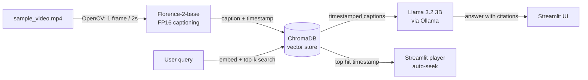

# 🎬 Temporal Video RAG System

Search a video in plain language and jump straight to the moment. Ask things like *"red car"* or *"when does someone enter the room?"* and the app finds the matching frames, answers with cited timestamps, and seeks the player to the right second.

Everything runs **100% locally**: no cloud APIs, no per-query cost, and no data leaves your machine. It is built to fit a **4GB VRAM GPU** (tested target: RTX 2050).

## How it works



**Ingestion (`ingest.py`)**
1. Samples one frame every 2 seconds with OpenCV.
2. Captions each frame with Microsoft Florence-2-base (`<DETAILED_CAPTION>`), loaded in FP16.
3. Stores each caption in ChromaDB with `{"timestamp": seconds}` metadata. Chroma's default embedding model (all-MiniLM-L6-v2) handles the text embeddings.

**Search and answer (`app.py`)**
1. Embeds your query and retrieves the top-k most similar captions (semantic search, cosine distance).
2. Sends the retrieved captions, in chronological order, to a local LLM that answers with cited `mm:ss` timestamps.
3. Plays the video from the best match's timestamp. Other matches can be selected from a list.

## Features

- Semantic search over video content: matches meaning, not just keywords
- Local RAG answers grounded in the retrieved frame descriptions
- Auto-seeking video player (`st.video(..., start_time=...)`)
- Resumable ingestion: re-running skips frames that are already indexed
- Handles missing video, missing or empty database, and an unreachable LLM gracefully

## Requirements

- Python 3.10+
- NVIDIA GPU with 4GB+ VRAM (CPU works for ingestion but is slow)
- [Ollama](https://ollama.com) for the answer-generation step (optional: search works without it)

## Setup

```bash
# 1. Clone the repo
git clone https://github.com/<your-username>/Temporal-Video-RAG-system.git
cd Temporal-Video-RAG-system

# 2. Install PyTorch with CUDA first (adjust the CUDA version to your system)
pip install torch torchvision --index-url https://download.pytorch.org/whl/cu121

# 3. Install the remaining dependencies
pip install -r requirements.txt

# 4. Pull the local LLM
ollama pull llama3.2:3b
```

**Model cache location:** `ingest.py` and `app.py` set `HF_HOME` to `D:/AI_Models_Cache` at the very top, so Hugging Face weights don't fill your system drive. Change that path to a folder that suits your machine.

**Video:** Add your own video as `sample_video.mp4` in the project root. Video files are git-ignored. H.264 MP4 plays most reliably in browsers; if you see a black player, re-encode with:

```bash
ffmpeg -i input.mp4 -c:v libx264 -pix_fmt yuv420p -c:a aac sample_video.mp4
```

## Usage

```bash
# Step 1: index the video (one-time per video)
python ingest.py

# Step 2: launch the app
streamlit run app.py
```

The first ingestion downloads the Florence-2 weights (under 1GB), so it takes longer. Progress prints per frame as captions are generated.

In the app, type a keyword or a question. The sidebar lets you toggle answer generation, change the Ollama model, and set how many frames to retrieve.

## Configuration

| Setting | Where | Default |
|---|---|---|
| Video path | `VIDEO_PATH` in both scripts | `sample_video.mp4` |
| Frame interval | `FRAME_INTERVAL_SEC` in `ingest.py` | 2 seconds |
| Caption beams (speed vs. quality) | `num_beams` in `ingest.py` | 3 |
| LLM model | sidebar, or `DEFAULT_MODEL` in `app.py` | `llama3.2:3b` |
| LLM context window | `num_ctx` in `app.py` | 4096 |
| Frames retrieved | sidebar slider | 8 |

If you change the video or sampling interval, delete the `chroma_db/` folder before re-ingesting.

## Project structure

```
.
├── ingest.py          # frame extraction, captioning, indexing
├── app.py             # Streamlit UI, retrieval, answer generation
├── requirements.txt
├── sample_video.mp4   # your video (git-ignored)
└── chroma_db/         # generated vector database (git-ignored)
```

## Troubleshooting

- **`cannot import name 'runtime_version' from 'google.protobuf'`**: TensorFlow is installed and conflicts with `transformers`. The scripts already set `USE_TF=0` to avoid this; you can also run `pip uninstall tensorflow`.
- **Slow answers**: run `ollama ps` and check the model is on `100% GPU`. Lowering `num_ctx` to 2048, retrieving fewer frames, or using `llama3.2:1b` all help.
- **"Model not found"**: run `ollama pull llama3.2:3b`.
- **CUDA out of memory during ingestion**: close other GPU-heavy apps. Frames that hit OOM are skipped.

## Limitations

- Answer quality is bounded by caption quality: if the captioner misdescribes a frame, the LLM repeats the error.
- Fixed 2-second sampling can miss very short events.
- Captions describe appearance only; speech and audio are not indexed.

## Roadmap

- Whisper transcription so spoken content is searchable
- Scene-change detection instead of fixed-interval sampling
- Cross-encoder reranking and hybrid (keyword + vector) search
- Additional Florence-2 tasks (OCR, object detection) as extra searchable text

## Tech stack

Python · PyTorch · Hugging Face Transformers · Florence-2 · OpenCV · ChromaDB · Streamlit · Ollama
